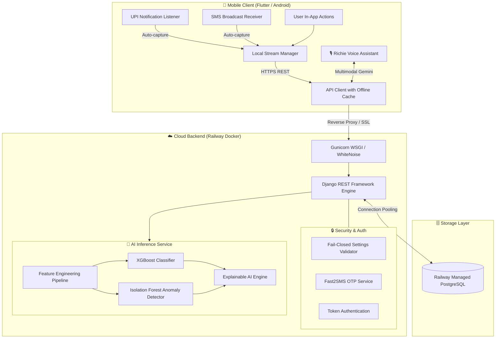

<div align="center">

# 🛡️ FraudLens
### *Next-Gen Autonomous Fraud Detection, Explainable AI & Financial Guardian*

[](https://fraudlens-production-b8753820.up.railway.app)
[](https://www.djangoproject.com/)
[](https://flutter.dev/)
[](https://www.postgresql.org/)
[](https://xgboost.readthedocs.io/)
[](https://deepmind.google/technologies/gemini/)

<p align="center">
  <b>Real-time transaction fraud scoring with dual-engine ML, Explainable AI (XAI), background UPI/SMS auto-capture, and an intelligent financial voice assistant.</b>
</p>

[🌐 Live API Status](https://fraudlens-production-b8753820.up.railway.app/api/health/) • [📱 Mobile App](#-mobile-experience) • [🧠 ML Architecture](#-machine-learning-pipeline) • [⚡ Quick Start](#-quick-start)

---

</div>

## 🌟 Overview

**FraudLens** is an end-to-end, production-grade fraud detection platform built to protect users from modern digital payment risks, identity theft, and rogue transactions. 

Unlike traditional rule-based banking alerts that warn users after money is gone, **FraudLens** runs background transaction auto-capture (Google Pay, PhonePe, Paytm, and bank SMS), runs real-time inference across an **ensemble of XGBoost and Isolation Forest models**, explains *why* a transaction is flagged using **Explainable AI (XAI)**, and allows instant freeze actions or natural conversation with **Richie**, a Gemini-powered AI financial investigator.

---

## ✨ Key Features

| Feature | Description |
| :--- | :--- |
| **⚡ Dual-Engine Ensemble ML** | Blends supervised gradient boosting (**XGBoost**) with unsupervised novelty detection (**Isolation Forest**) to catch both known fraud patterns and zero-day anomalies. |
| **🔍 Explainable AI (XAI)** | Real-time feature impact decomposition providing clear, human-understandable explanations for why a score was assigned. |
| **👤 Adaptive Personal Baselines** | Phase-graduated personal habit weighting: starts with global security rules and seamlessly adapts as the user's spending habits mature. |
| **📲 Zero-Friction UPI Auto-Capture** | Native Android `NotificationListenerService` that transparently intercepts and scores UPI payments from **Google Pay**, **PhonePe**, and **Paytm**. |
| **📩 Live Bank SMS Parsing** | Automatic background detection and regex parsing of bank debit/credit transaction alerts. |
| **🎙️ Richie AI Assistant** | Google Gemini-powered voice companion capable of analyzing disputed transactions, answering policy queries, and guiding dispute resolutions. |
| **☁️ Production Cloud Infrastructure** | Deployed on **Railway** with managed **PostgreSQL**, containerized via Docker, hardened with strict SSL/HSTS policies, and zero debug leaks. |
| **🔐 Real SMS OTP Verification** | Live OTP phone authentication powered by **Fast2SMS** for instant, passwordless onboarding. |

---

## 🏗️ System Architecture



---

## 🧠 Machine Learning Pipeline

FraudLens utilizes a multi-tiered decision engine trained and benchmarked against comprehensive transaction profiles:

1. **Supervised Classifier (XGBoost):**
   - High-precision detection of velocity anomalies, abnormal amounts, merchant categories, and cross-channel irregularities.
2. **Unsupervised Detector (Isolation Forest):**
   - Identifies multi-dimensional outlier transactions that do not conform to any standard global distribution.
3. **Personal Graduation Algorithm:**
   $$\text{Final Score} = (1 - w_p) \cdot \text{Score}_{\text{global}} + w_p \cdot \text{Score}_{\text{personal}}$$
   - Where $w_p \in [0.0, 0.4]$ scales dynamically with verified user transaction history.
4. **Explainable AI (XAI) Output:**
   - Instead of an opaque number, every scored transaction returns human-actionable insights:
     > *"Amount ₹1,50,000.00 is significantly above typical card spending limits."*  
     > *"First time this card was used at an overseas merchant."*

---

## 💻 Tech Stack

### Mobile Frontend
- **Framework:** [Flutter 3.x](https://flutter.dev/) (Dart)
- **State Management:** Provider / BLoC Pattern
- **Platform Channels:** Android Native Kotlin (`NotificationListenerService`, `BroadcastReceiver`)
- **UI Architecture:** Cyberpunk Glassmorphic Material 3, `fl_chart` dynamic telemetry

### Web Backend & API
- **Framework:** [Django 5.2](https://www.djangoproject.com/) + Django REST Framework
- **WSGI Server:** Gunicorn (Multi-worker, multithreaded)
- **Static Assets:** WhiteNoise storage pipeline
- **Reverse Proxy:** Railway Edge with dynamic SSL/HSTS termination

### Database & Cloud
- **Database:** PostgreSQL (with `dj-database-url` and connection pooling)
- **Hosting:** [Railway](https://railway.com/) Container Infrastructure (Linux Docker runtime)
- **LLM / Conversational AI:** Google Gemini Nano / Pro via Gemini API

---

## ⚡ Quick Start

### 1. Prerequisites
- **Python 3.11+**
- **Flutter SDK 3.x**
- **Android Studio / ADB**
- **Git**

### 2. Backend Local Setup
```bash
# Clone the repository
git clone https://github.com/Anshul-3107/FraudLens.git
cd FraudLens

# Activate virtual environment
python -m venv .venv
source .venv/bin/activate  # On Windows: .venv\Scripts\activate

# Install dependencies
pip install -r requirements.txt

# Run migrations & start development server
cd backend
python manage.py migrate
python manage.py runserver 0.0.0.0:8000
```

### 3. Mobile App Local Setup
```bash
cd mobile

# Install dependencies
flutter pub get

# Run on connected Android device or emulator
flutter run
```

---

## 📦 Standalone Release Installation

A standalone release APK configured to connect directly to the live Railway production cloud is available:

- **Pre-built APK:** `FraudLens.apk` *(located in project root)*
- **Install via ADB:**
  ```bash
  adb install -r FraudLens.apk
  ```
- Or transfer `FraudLens.apk` directly to any Android smartphone via WhatsApp, Google Drive, or USB.

---

## 🌐 Live Production Endpoints

| Endpoint | Method | Description |
| :--- | :--- | :--- |
| `GET /api/health/` | `GET` | Service & DB health check |
| `POST /api/auth/register/` | `POST` | User registration & token generation |
| `POST /api/auth/login/` | `POST` | Authenticate existing user |
| `POST /api/auth/phone/send-otp/` | `POST` | Dispatch live SMS OTP via Fast2SMS |
| `POST /api/auth/phone/verify-otp/` | `POST` | Verify OTP and authenticate |
| `POST /api/transactions/` | `POST` | Submit transaction for real-time ML fraud scoring |
| `POST /api/transactions/process_notification/` | `POST` | UPI notification auto-capture parser |
| `GET /api/summary/` | `GET` | User risk telemetry & transaction analytics |
| `GET /api/alerts/` | `GET` | Active security alerts feed |

---

## 🔒 Security & Privacy Notice

> **Data Disclosure & Privacy:** FraudLens does not store raw credit card CVVs or unencrypted PINs. Simulated transaction datasets (Sparkov generator) are used for model training. Real UPI notification titles and bank SMS messages captured locally on the device are processed through secure, tokenized API channels and retained solely for user-authorized fraud investigations.

---

<div align="center">
  <sub>Engineered with precision for secure, intelligent personal finance.</sub><br>
  <b>© 2026 FraudLens Team. All rights reserved.</b>
</div>
